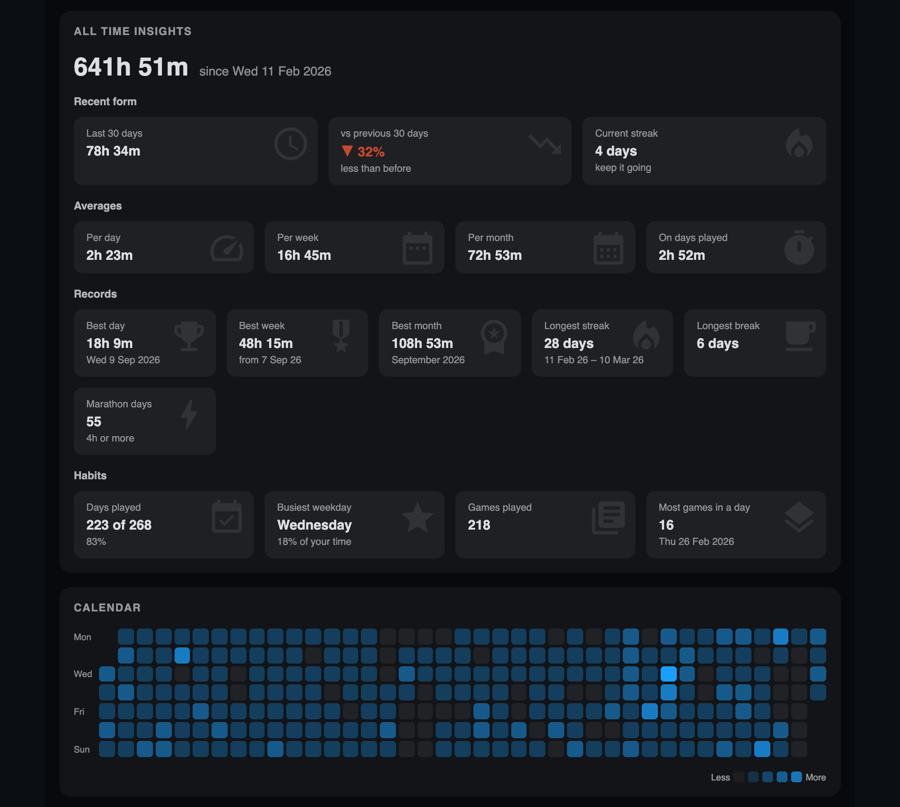
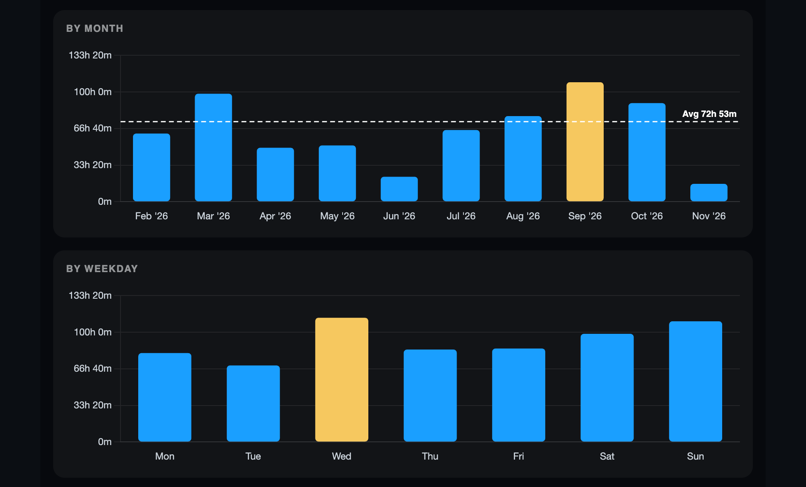
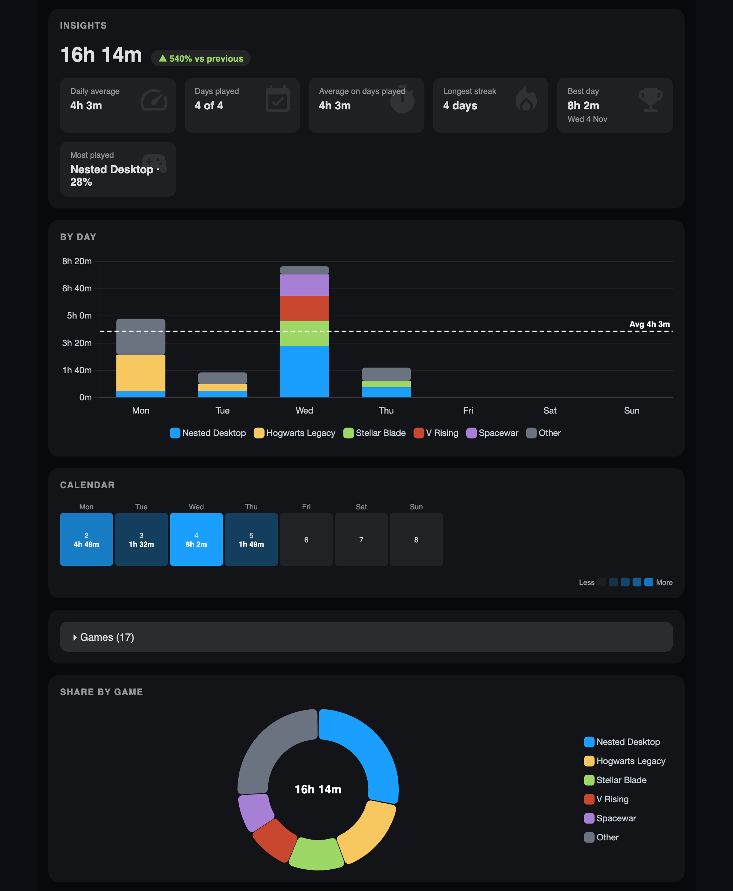
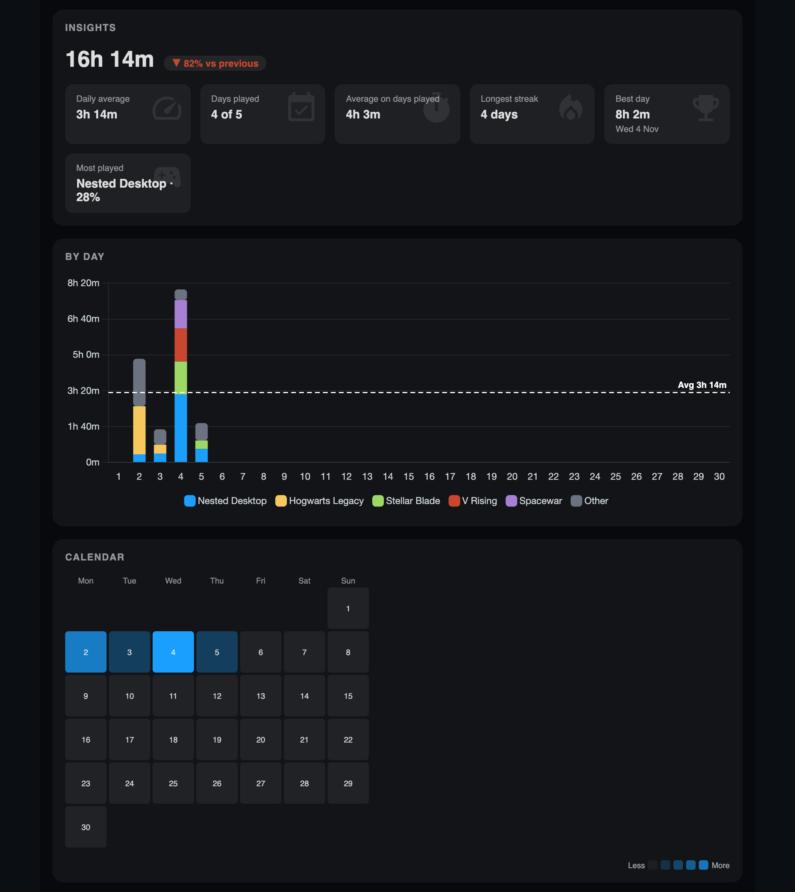
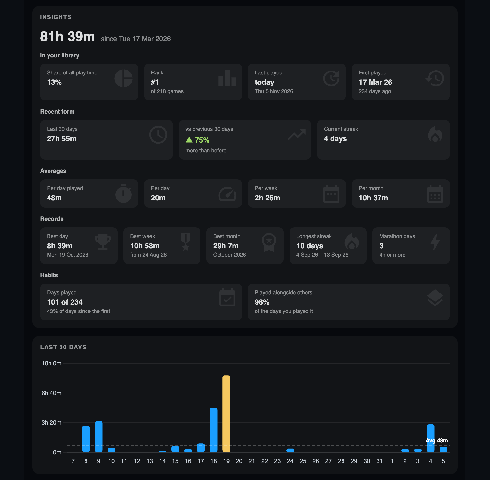

# PlayTime


PlayTime is a [Decky Loader](https://decky.xyz) plugin for the Steam Deck that tracks how long you play Steam and non-Steam games and turns it into reports, charts and insights.

## Origin

This project started from [SDH-PlayTime](https://github.com/ma3a/SDH-PlayTime) by ma3a, which has been archived and is no longer maintained. I took the archived code as a base and added a lot on top of it: the charts were rebuilt on Chart.js, and I added insights at every level, a per-game table and page, a calendar heatmap, hidden games, controller shortcuts and a redesigned, more modern dashboard. The tracking engine and the original idea are still ma3a's work, see [Credits](#credits).

## Features

**Dashboard** (open it from the PlayTime button at the bottom right of the library home, or from the Decky menu)

- **All Time**: total play time, recent form, averages per day / week / month, records (best day, week and month, longest streak, marathon days), habits, a calendar heatmap and charts by month and by weekday.
- **By Month** and **By Week**: stacked daily bars per game with the daily average drawn as a line, share of time by game, insights compared with the previous period and a calendar heatmap. Use **L2 / R2** to move to the previous / next period without losing focus.
- **Games table**: a collapsible table with play time, share, days played, average per day, best day, last played and change versus the previous period.
- **Game page**: select a game in any table to see its own insights (share of your library, rank, first and last played, averages, records, streaks) and charts for the last 30 days, by month and by weekday. Press **B** to go back.
- **Hidden games**: hide games or apps you don't want in the dashboard with **Hide** and bring them back from the *Hidden games* list. Hiding only affects the dashboard, play time keeps being recorded. The filter is stored in the plugin database.

**Tracking and settings**

- Tracks Steam and non-Steam games, including suspend and resume.
- Optional reminder to take a break after a configurable time of continuous play.
- Manual correction of the overall play time of a game.
- Shows your tracked play time on game pages and in the library.

All data stays on your Deck, in a local SQLite database in the plugin data directory.

## Screenshots

Captured from the local dev server (see [Development](#development)), so the Steam interface around the dashboard is not shown.

**All Time**





**By Week** and **By Month**





**Game page**



## Installation

Download the latest release zip, copy it to the Deck and install it from Decky Loader (*Settings → Developer → Install plugin from ZIP*, with developer mode on). To build it yourself, see below.

## Development

Requirements: Node.js, [pnpm](https://pnpm.io) 8.6 or newer, Python 3.

```shell
pnpm i
pnpm build      # builds dist/index.js
make zip        # builds build/<folder>-<version>.zip, ready to install
make verify     # Python and Jest tests
```

`make deploy` copies the plugin to the Deck over SSH. It reads the connection settings (`deckip`, `deckport`, `deckpass`, `deckkey`, `deckdir`) from `.vscode/settings.json`, which is git-ignored.

### Local dev server

Work on the dashboard in a browser, without a Deck:

1. Copy a `storage.db` from your Deck to `dev/storage.db` (git-ignored, it contains personal data).
2. Run `pnpm dev` and open http://localhost:5173.

The dev backend serves the statistics from a throw-away copy of that database. Decky UI components are replaced by small browser stand-ins, so the layout is representative but focus and controller navigation are not.

### Project layout

- `src/`: frontend (TypeScript, React, Chart.js)
- `main.py`, `defaults/python/`: backend (SQLite) and its tests
- `test/`: Jest tests for the frontend logic
- `dev/`: local dev server

## Contributing

Issues and pull requests are welcome. Please run `make verify` and `npx tsc --noEmit` before submitting.

## Credits

- [ma3a](https://github.com/ma3a), original author of SDH-PlayTime, and Witherking25
- The [Decky Loader](https://decky.xyz) project

## License

BSD 3-Clause, see [LICENSE](LICENSE).
